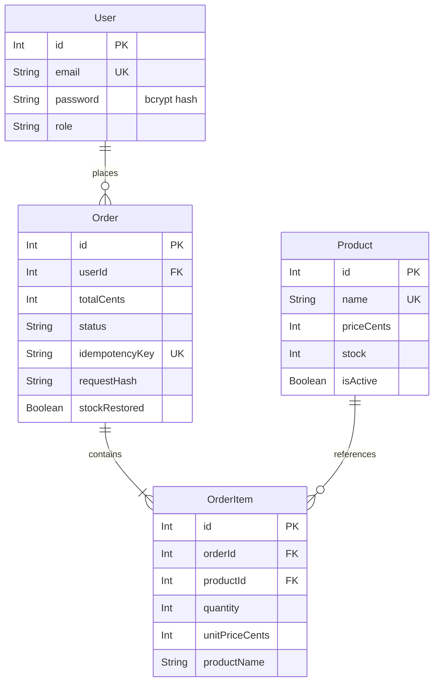

# Implemented data design

The diagram focuses on keys and integrity fields; schema.prisma also contains display names, descriptions, tags, images, timestamps and shipping address. The actual User field is `password`, storing a bcrypt hash; it is not named passwordHash. Order creation enforces at least one item in the API transaction; the database foreign key alone does not enforce that minimum.

| Data | Storage rule | Verification |
| --- | --- | --- |
| Money | Signed 32-bit integer cents; non-negative; decimal input at most two places | Money tests and SQL CHECKs |
| Stock | Non-negative integer; conditional decrement in checkout transaction | Rollback and concurrent-buyer HTTP tests |
| Quantity | API allows 1–100 per product, combines duplicate lines; DB positive integer | Validation and direct SQL tests |
| Snapshot | Item name/unit cents copied when order is created | Rename/archive HTTP test |
| Archive | isActive false hides catalogue item, preserves FK/history | Archive/restore HTTP test |
| Idempotency | Unique key plus user/content hash | Replay, changed-request and different-user tests |
| Cancellation | Status update, stock return and flag saved atomically | Repeated cancellation test |
| User | Unique normalized email; role read from DB for protected requests | Authentication/authorization tests |

Migration history: 20260822164011_init; 20260822170456_add_shipping_address; 20260822181338_add_product_image_url; 20260924205436_reliable_orders; 20260924215024_data_integrity_phase4.

The first three GitHub migrations are retained byte-for-byte. The ZIP supplies the last two. Legacy item names are backfilled from the name available at migration time; earlier renamed values cannot be recovered. Custom SQLite CHECK constraints are in SQL and are not fully represented in Prisma's model language. Inspect future generated table rebuilds to retain them. Back up and run migration fixtures before applying future schema changes.
